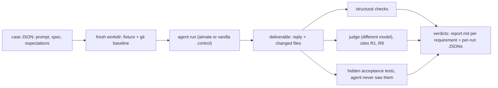

# Evals

Behavioral (layer 3) evaluation of the aimate plugin: a real agent runs a case's prompt against a fixture project, and the result is graded against fixed requirements. Every run spends real tokens, so this runs on demand and never in CI. The free, deterministic checks live in `tests/`.

## Running

```bash
node evals/runner/run-eval.mjs all                       # every case, aimate pipeline
node evals/runner/run-eval.mjs 13-php-permissions-model  # one case
node evals/runner/run-eval.mjs all --pipeline vanilla    # control: no skill plugins
node evals/runner/run-eval.mjs all --runs 3              # baseline-grade: report mean and spread
node evals/runner/run-eval.mjs all --dry-run             # print the plan only
node evals/runner/report.mjs --latest                    # report over the newest run only
node evals/runner/report.mjs --last 6                    # the newest 6 result dirs (one sweep looped over cases)
node evals/runner/report.mjs <results dirs...>           # specific dirs; --write-baseline pins evals/baseline.json
```

The runner enables exactly one pipeline's plugin for the duration of a sweep (and re-enables aimate afterwards), so results are never contaminated by another plugin's routing. The two shipped pipelines are `aimate` and `vanilla`, because every finding needs the does-aimate-beat-no-plugin control. To compare against another skill plugin, declare it in `evals/runner/pipelines.local.json` (untracked); the shipped suite measures aimate against vanilla, not against third-party plugins. Generator and judge are different models by construction (defaults: sonnet generates, opus judges) and the report header records both plus the Claude Code version, because results shift across model and CLI versions.

Every invocation writes its own `evals/results/<timestamp>/` folder (gitignored): one JSON per run with the full artifact, checks, cost and fired skills, plus a `report.md` for that invocation. A report across invocations (for example a whole race) is `node evals/runner/report.mjs <results dirs...> --out file.md`; in CI the same files upload as workflow artifacts. The report is written for a PR reviewer or a curious contributor, not as a run log: findings are grouped per requirement with a verdict (holding / failing / mixed), one or two curated evidence quotes, the vanilla control's pass rate, and, once `evals/baseline.json` is pinned via `report.mjs --write-baseline`, the delta against baseline with regressions marked. Per-run detail sits in a scorecard appendix and the JSONs; grader failures and timeouts are listed under suite health, apart from findings about aimate itself.

## One behavioral run



## Cases

One JSON file per case under `evals/cases/<group>/`:

```json
{
  "id": "13-php-permissions-model",
  "fixture": "php-app",
  "pipeline": "decompose",
  "prompt": "the exact user message, verbatim",
  "spec": ["the input spec, line by line"],
  "expect": [
    { "check": "between 3 and 8 tickets", "by": "structural", "type": "ticket_count", "min": 3, "max": 8 },
    { "check": "first ticket is a preparatory refactor", "by": "judge", "req": "R1" }
  ],
  "behavioral": true
}
```

Every expectation names its verifier. `structural` checks run as deterministic rules over the artifact (`ticket_count`, `single_ticket_or_none`, `demo_line_per_ticket`, `no_see_spec_reference`, `regex_present`, `regex_absent`). `judge` checks are graded by the judge model against `evals/rubrics/requirements.md`, citing the requirement id in `req`; the artifact is fenced as untrusted data. Cases define expected properties, never one right answer. The runner refuses a case missing `id`, `prompt`, `spec` or `expect`.

`evals/rubrics/requirements.md` holds the numbered requirements every judged check cites; changing a requirement is a normal reviewed pull request. `evals/fixtures/` holds the starter projects cases run against (each a small real app with passing tests). Rejected skill changes belong in `evals/REJECTED.md` so prior attempts stay visible.

## Delivery cases and the strategy race

Decomposition and pressure cases grade an artifact. Delivery cases (`"type": "delivery"`) grade the deliverable itself: the agent implements the work item against the fixture, and quality is measured by a held-out acceptance script the agent never sees (`evals/acceptance/<id>/run.sh`, run against the workdir afterwards; verify every new script fails on the untouched fixture and passes on a correct implementation) plus a judge review of the produced diff counting findings by severity. Cost and turns are recorded but only break ties at equal quality.

Each delivery case names its `entry_state`, the state the work arrives in (tiny-change, refined-ticket, raw-ticket, greenfield, legacy-change), and runs under a strategy arm. Reports print the arm names, so here is what each one does:

| Arm | What the agent is told | Family |
|---|---|---|
| `direct` | implement it, nothing more | scaffold (no skills named) |
| `validate-implement` | first challenge the ticket against the codebase, then implement | scaffold |
| `spec-first` | write a spec and a plan first, then implement per plan | scaffold |
| `spikeN` | N independent throwaway attempts; the hidden tests pick the winner | scaffold, reliability only |
| `spike-informedN` | N reduced-budget throwaway attempts, then one fresh build that studies their diffs and reports | scaffold |
| `aimate-implement` | use the implement-ticket skill | explicit skill |
| `aimate-validate-implement` | prepare-ticket skill, then implement-ticket skill | explicit skill |
| `aimate-plan` | write-plan skill, then implement the plan | explicit skill |
| `aimate-full` | the documented SDLC: prepare-ticket, grilling, write-prd, grilling, write-plan, implement-ticket | explicit skill |

The scaffold arms measure workflow shapes on the base model; each explicit arm against its scaffold twin (aimate-plan versus spec-first, for example) isolates what the skill's instructions add, with routing taken out of the picture. Pick an arm like this:

```bash
node evals/runner/run-eval.mjs d01-tiny-change-date-bug --strategy direct
node evals/runner/run-eval.mjs d01-tiny-change-date-bug --strategy validate-implement
node evals/runner/run-eval.mjs d01-tiny-change-date-bug --strategy spec-first
node evals/runner/run-eval.mjs d01-tiny-change-date-bug --strategy spike --spikes 3
node evals/runner/run-eval.mjs d02-refined-ticket-deactivate-user --strategy aimate-validate-implement
```

The report's "Strategy race" section aggregates these into a per-entry-state table. The purpose is a routing answer, which path fits which starting state, measured on deliverable quality rather than argued from taste.

## Reading results

Scores from agent runs are stochastic. Compare runs only at equal model and CLI versions, prefer three runs per case and read the spread before the mean, and treat a delta smaller than the observed spread as noise. A budget or efficiency result only counts when the same run's quality checks pass.
