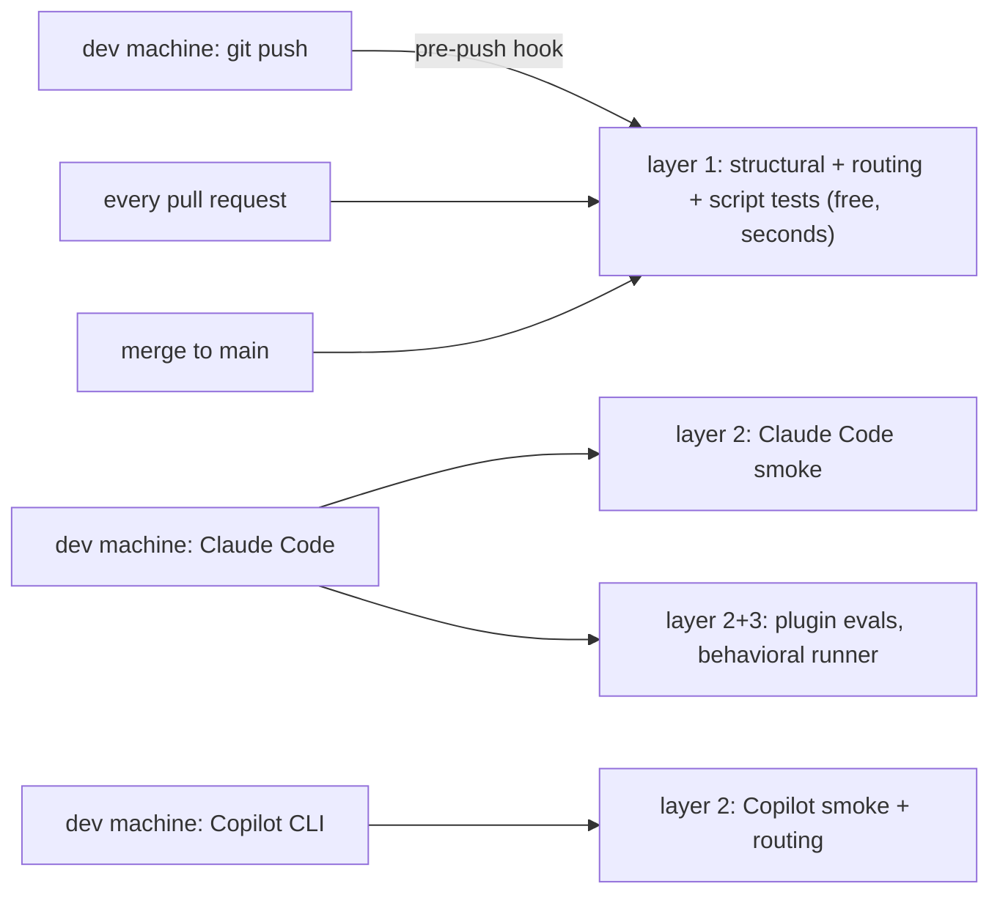

# Tests

Automated checks for the aicelerate marketplace and the aimate plugin. The suite is tiered by cost: structural checks are free and deterministic and run in CI on every pull request; host smoke tests and evals call a real agent CLI and run locally, since CI has no authenticated agent access.

## Layout

```
tests/
  structural/     deterministic validation of manifests, skills and links (CI, blocking)
  triggers/       deterministic skill-routing checks over descriptions (CI, blocking)
  python/         unit tests for the Python scripts the aimate-ios skills run (CI, blocking)
  claude-code/    headless smoke tests against the Claude Code CLI
  copilot-cli/    headless smoke tests against the GitHub Copilot CLI
  manual/         checklists for hosts without a headless mode
```

## Structural validation

```bash
node tests/structural/validate-plugin.mjs
```

Validates, with no dependencies and no network:

- `marketplace.json` parses and every plugin `source` path exists.
- `plugins/aimate/plugin.json` parses, and its `version` matches both the marketplace entry and the newest `## x.y.z` heading in `RELEASE_NOTES.md`.
- Every directory under `plugins/aimate/skills/` contains a `SKILL.md` whose frontmatter has `name` and `description`, with `name` equal to the directory name.
- Every relative markdown link in a `SKILL.md` or its `references/` resolves to an existing file. Bare `…` targets are treated as placeholders in example content and skipped.
- No `SKILL.md` exceeds the line budget (500 lines, set at the top of the script).

Exit code 0 means all checks passed; any violation prints one line per finding and exits 1. A failure here means the plugin is broken as shipped. Fix the finding, don't loosen the check.

## When which check runs



## What you need for which layer

| Layer | Needs | Claude Code only | Copilot CLI only |
|---|---|---|---|
| 1 — structural + routing checks, script tests | Node and Python 3.9+ (plus git; `swift` and `plutil` for the tests that use them) | ✓ | ✓ |
| 2 — host smoke + promise-and-fire | the host CLI, authenticated | `tests/claude-code/`, `claude plugin eval` | `tests/copilot-cli/` (smoke + routing) |
| 3 — behavioral evals | Claude Code CLI + API access | ✓ | ✗ for now (the runner drives `claude`; a Copilot-driven runner is planned, the session events already give it a trace) |

Each host suite skips cleanly when its CLI is missing, so running everything you have is always safe.

## Before you open a PR (developer workflow)

Enable the layer-1 hook once; it runs the free checks on every push, in seconds:

```bash
git config core.hooksPath tests/hooks
```

When your change touches a skill or its description, also run the paid checks it affects and paste the result in the PR: `claude plugin eval ./plugins/aimate --case <the relevant case>` for firing and promise, `tests/copilot-cli/test-routing.sh` when routing matters on Copilot, and the behavioral cases your change claims to improve (`node evals/runner/run-eval.mjs <case-id>`). CI re-runs only the free layer; every paid result only you can produce.

## When what runs (CI)

`.github/workflows/test.yml` runs one job: on every pull request and merge to main, the free deterministic checks (structural + routing + script tests) run and block on failure.

The paid layers run locally, not in CI, because the runners have no authenticated agent access: there is no Anthropic API key for this repo (the Claude Code smoke tests and the eval runner both drive `claude` for real), and the Copilot CLI needs an interactively authenticated GitHub account with a Copilot entitlement. If a key or a Copilot service account becomes available, the same scripts run unchanged in a workflow. Result folders are gitignored; eval scores are advisory against the pinned baseline, never a merge gate — the reasoning is in `evals/README.md`.

## Script tests

```bash
xcrun python3 -m unittest discover -s tests/python   # Xcode's Python 3.9, the version the skills run on
python3 -m unittest discover -s tests/python -v      # any Python 3.9+, one line per test
python3 -m unittest discover -s plugins/aimate/skills/asvs-audit/scripts -p 'test_*.py'
```

`tests/python/` holds one `test_<script>.py` per script under `plugins/aimate-ios/skills/*/scripts/`, written with the standard library's `unittest` so they need no install. `support.py` loads a script by its path (skill folders have dashes, so they can't be imported normally), runs it as a command, and gives each repository-scanning test a fresh git repository to write fixture files into. `fixtures/App.pbxproj` is a small but real Xcode project (one app target, a local and a remote package product) shared by the `ios_platform`, `swift_modules`, and `uikit_inventory` tests; `plutil -lint` accepts it.

Tests that need a tool skip when it is missing: git for everything that scans a repository, `swift` for the `swift_modules` end-to-end test, and `plutil` (macOS only) for the `uikit_inventory` end-to-end test. CI runs on Linux, so run the suite on a Mac before pushing changes to `uikit_inventory.py`. `token_usage.py` has no tests: it measures our own sessions and no skill output depends on it.

When you change a script, add a test for the behavior you changed, and keep the script and its tests working on Python 3.9.

## Trigger and routing checks

```bash
node tests/triggers/run-triggers.mjs                 # report, exit 1 on violations
node tests/triggers/run-triggers.mjs --min-rank1 90  # enforce the rank-1 floor (%)
node tests/triggers/run-triggers.mjs --verbose       # top-3 ranking per prompt
```

`tests/triggers/prompts.json` holds, per skill, positive prompts (things a developer actually types that must route to the skill) and negative prompts (adjacent requests that must not). The checker ranks each prompt against every skill description with stemmed TF-IDF over unigrams and bigrams, cosine-normalized so long descriptions carry no advantage, and also flags any two descriptions similar enough to misroute (allow-list intentional pairs under `collision_allow`).

This is a lexical approximation of routing: it catches a description missing the vocabulary users type, and an over-broad description that outranks the right skill. It cannot judge semantics; prompts that need semantic routing, non-English phrasings for example, go under `tier3_only` and are exercised by the behavioral tier instead. A failure here usually means the description needs fixing, not the eval.

When adding or changing a skill, add its prompts here in the same pull request; the structural and trigger checks both run in CI and block merge.

## Claude Code smoke tests

```bash
tests/claude-code/run-tests.sh                    # all tests
tests/claude-code/run-tests.sh --test test-skills-load.sh
tests/claude-code/run-tests.sh --verbose --timeout 600
```

Requires the `claude` CLI on PATH with the aimate plugin installed; without it the tests skip with exit code 0 and a clear message. Two tests run:

- `test-skills-load.sh` asks a headless session to list aimate skills and asserts the core skill names appear.
- `test-skill-fires.sh` sends one natural developer prompt per core skill and asserts from the `stream-json` trace that the matching skill was invoked. Routing is stochastic, so each prompt gets up to `RUNS` attempts (default 3) and passes on any fire; this proves a skill can fire, not that it fires reliably.

These run locally only (see "When what runs (CI)" above). Install aimate from your checkout first (`claude plugin marketplace add ./ && claude plugin install aimate@aicelerate`) so the version under review is what gets tested.

## Copilot

The Copilot CLI has its own smoke tests (`tests/copilot-cli/run-tests.sh`) and routing evals (`tests/copilot-cli/test-routing.sh`); the routing evals read fire verdicts from the `skill.invoked` events in the session log, not from reply text, and share their prompts with the Claude Code plugin-eval cases so both hosts are measured on identical phrasings. Setup and history: `tests/copilot-cli/README.md`. Copilot desktop and Copilot in VS Code have no headless mode and are covered by the release checklists in `tests/manual/`, each carrying a "last verified" header that release PRs update.
